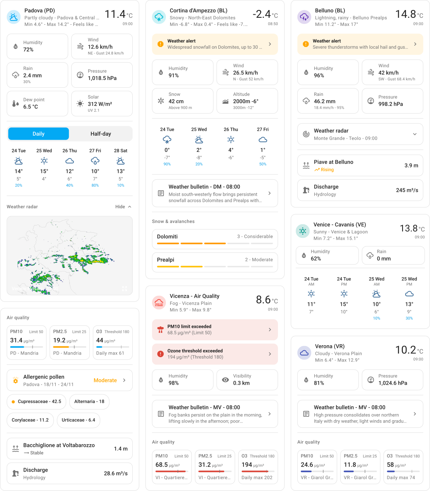

<p align="center">
  
</p>

<p align="center">
  
</p>

<p align="center">
  <strong>Official ARPA Veneto weather, forecasts, alerts, radar, air quality,<br>
  hydrology, snow/avalanches and pollen for Home Assistant.</strong>
</p>

<p align="center">
  <a href="https://github.com/fabioscarparo/ha-arpav-meteo/releases/latest"></a>
  <a href="https://hacs.xyz/docs/faq/custom_repositories"></a>
  <a href="https://www.home-assistant.io/"></a>
  <a href="https://www.python.org/"></a>
  <a href="LICENSE"></a>
</p>

A custom [Home Assistant](https://www.home-assistant.io/) integration for
**ARPA Veneto** (ARPAV), the Regional Agency for Environmental Prevention and
Protection of Veneto, Italy. It connects directly to ARPAV's public REST, XML
and JSON feeds with no API keys or accounts required.

- **Real-time weather stations**: temperature, dew point, humidity, atmospheric
  pressure, visibility, wind speed and direction, global solar radiation,
  estimated UV index, leaf wetness, snow depth and precipitation (5-minute,
  hourly intensity, rolling 1h/3h/6h/12h/24h totals and daily total since
  midnight).
- **24-hour extremes and comfort**: daily min/max temperature, max wind speed,
  wind gusts (exposed natively on the `weather` entity) and apparent
  temperature (`humidex` / `windchill`).
- **Regional forecasts and weather alerts**: daily and twice-daily forecasts in
  Italian or English, snow line and mountain altitude temperatures, full
  textual bulletins and an active weather alert binary sensor for automations.
- **Weather radar**: live `image` entity showing the Veneto Radar Mosaic, Monte
  Grande (Teolo) radar or Concordia Sagittaria radar.
- **Validated air quality**: distance-sorted stations for PM10, PM2.5 and Ozone
  with strict ARPAV validity filtering (`FLAG >= 9`), hourly and official daily
  averages, plus EU threshold exceedance binary sensors.
- **Hydrology**: 120 distance-sorted river stations with water level, trend and
  discharge.
- **Snow, avalanches and pollen**: Dolomiti and Prealpi AINEVA avalanche danger
  levels, plus provincial allergenic pollen reports with per-species grain
  counts.
- **Optional METAR and sky brightness**: aerodrome cloud cover and missing
  visibility/pressure fallback via NOAA Aviation Weather Center, plus long-term
  statistics archiving for night sky brightness.
- **Built-in Lovelace card**: native Home Assistant dashboard card served
  automatically by the integration (no extra HACS plugin or manual resource
  needed), with a full visual editor to toggle header, alerts, weather details,
  daily/twice-daily forecasts, radar, textual bulletin, air quality, pollen,
  hydrology and avalanches.
- **English and Italian**, following Home Assistant's configured language.

<picture>
  <source media="(prefers-color-scheme: dark)" srcset="docs/images/wall-dark.svg">
  
</picture>

## Quick start

1. [Install](#installation) the integration via HACS and restart Home Assistant.
2. [Set it up](#setup) by choosing your Veneto municipality and nearest weather
   station.
3. Open **Configure** on the integration to enable optional modules (radar,
   air quality, hydrology, pollen, avalanches or METAR).

## Installation

### Requirements

- Home Assistant **2025.1** or later (**2026.3** or later to show the
  integration's icon, which ships inside the integration)
- [HACS](https://hacs.xyz/) (recommended)

### Install with HACS

This integration is not in the default HACS store yet: add it as a custom
repository.

[](https://my.home-assistant.io/redirect/hacs_repository/?owner=fabioscarparo&repository=ha-arpav-meteo&category=integration)

1. Open **HACS**, then **⋮ -> Custom repositories**.
2. Add `https://github.com/fabioscarparo/ha-arpav-meteo` with category
   **Integration**.
3. Search for **ARPA Veneto Meteo**, open it and select **Download**.
4. Restart Home Assistant.

### Manual installation

Copy `custom_components/arpa_veneto_meteo/` into your Home Assistant
`config/custom_components/` folder and restart Home Assistant.

## Setup

[](https://my.home-assistant.io/redirect/config_flow_start/?domain=arpa_veneto_meteo)

1. Go to **Settings -> Devices & services -> Add integration** and search for
   **ARPA Veneto Meteo** (or click the button above).
2. Choose your **Municipality** to automatically look up the matching ARPAV
   forecast zone.
3. Confirm the **Forecast zone** and pick your **Weather station**, sorted by
   distance from the chosen municipality (from the zone point if the
   municipality has no coordinates).

You can change the zone or weather station later from **Reconfigure** without
deleting the entry, and you can add multiple instances for different locations.

### Options

Open **Settings -> Devices & services -> ARPA Veneto Meteo -> Configure**:

| Option | Default | Description |
|---|---|---|
| Update interval | `10 min` | Station polling interval (`5-60` minutes). Slow-changing feeds use longer internal caches. |
| Forecast bulletin language | `Auto` | Uses Italian when Home Assistant is set to Italian, English otherwise (or force `it` / `en`). |
| Weather radar image | `Veneto Radar Mosaic` | Choose Veneto Mosaic (PNG), Monte Grande - Teolo, Concordia Sagittaria, or disable. |
| Regional bulletin and alerts | `On` | Enables the textual bulletin sensor and the active weather alert binary sensor. |
| Snow and avalanche bulletin | `Auto` | Enabled automatically for mountain zones; adds Dolomiti and Prealpi danger sensors. |
| Current condition inference | `Automatic` | Computes current sky condition from station sensors, METAR or forecast (supports custom thresholds). |
| Archive night sky brightness | `Off` | Imports ~72h of ARPAV sky brightness readings daily at 11:15 as external Recorder statistics. |
| Air quality (section) | Off | Distance-sorted PM10, PM2.5 and Ozone stations. |
| Hydrology (section) | Off | Distance-sorted river hydrometric station (level, trend and discharge). |
| Allergenic pollen (section) | Off | Distance-sorted provincial pollen station. |
| METAR (section) | Off | Distance-sorted aerodrome for cloud cover and missing pressure/visibility fallback. |

## Entities

Only sensors supported by the selected station or enabled in options are
created, keeping the device clean without permanently `unknown` entities.

### Weather

| Entity | Description |
|---|---|
| **Weather** | Current condition, temperature, apparent temperature, dew point, humidity, pressure, wind speed, 24h wind gust, wind bearing, visibility, UV index, METAR cloud coverage, plus daily and twice-daily forecasts. Attributes include condition provenance, snow line, altitude temperatures and active alert text. |

### Weather and 24h Sensors

| Entity | Unit | Notes |
|---|---|---|
| Temperature, Min / Max (24h), Dew point, Apparent temperature | `°C` | Apparent temperature uses windchill when cold and humidex when warm |
| Humidity | `%` | |
| Atmospheric pressure | `hPa` | Station measurement or METAR fallback |
| Visibility | `km` | Station measurement or METAR fallback |
| Wind speed, Max wind speed (24h), Wind gust (24h) | `km/h` | Converted from ARPAV `m/s` |
| Wind direction | `°` | Numeric degrees with 16-point `cardinal` attribute |
| Solar radiation | `W/m²` | Global horizontal irradiance (`RADSOL`) |
| UV index | `UV index` | Estimated from global solar radiation |
| Leaf wetness | `%` | Agrometeo stations (`BFOGL`) |
| Snow depth | `cm` | Mountain/snow stations (`NIVOM`) |
| Snow line | text | Forecast snow altitude when reported for the zone |
| Weather bulletin | text | Summary state with full daily texts and general evolution in attributes |

### Precipitation Sensors

| Entity | Unit | State class | Notes |
|---|---|---|---|
| Precipitation (last 5 min) | `mm` | `measurement` | Latest 5-minute gauge reading |
| Precipitation intensity | `mm/h` | `measurement` | Instantaneous rate derived from 5-minute reading |
| Precipitation (last 1h / 3h / 6h / 12h / 24h) | `mm` | `measurement` | Rolling windows (decrease naturally as older rain leaves the window) |
| Precipitation today | `mm` | `total_increasing` | Cumulative rainfall since `Europe/Rome` midnight |
| Precipitation probability | `%` | `measurement` | From nearest forecast period |

### Optional Modules (Air Quality, Hydrology, Avalanches, Pollen)

| Entity | Platform / Unit | Notes |
|---|---|---|
| PM10 (hourly, daily mean) | `sensor`, `µg/m³` | Validated readings only (`FLAG >= 9`) |
| PM2.5 (hourly, daily mean) | `sensor`, `µg/m³` | Validated readings only (`FLAG >= 9`) |
| Ozone (O3) | `sensor`, `µg/m³` | Hourly validated reading with `daily_max` attribute |
| River level | `sensor`, `m` | Includes `trend` (`=`, `+`, `-`) attribute |
| River discharge | `sensor`, `m³/s` | Created when the hydrometric station reports discharge (`PORT`) |
| Avalanche danger (Dolomiti, Prealpi) | `sensor` (enum) | AINEVA 1-5 scale (`not_issued` out of season), fresh snow and situation in attributes |
| Pollen risk | `sensor` (enum) | `absent` / `low` / `moderate` / `high` with full species breakdown in attributes |
| Pollen `<species>` | `sensor`, `granuli/m³` | One numeric sensor per monitored species when a pollen station is selected |
| Weather alert | `binary_sensor` (`safety`) | `on` when ARPAV reports an active weather alert or special phenomena |
| PM10 limit exceeded | `binary_sensor` (`problem`) | `on` when official daily mean PM10 exceeds `50 µg/m³` |
| Ozone threshold exceeded | `binary_sensor` (`problem`) | `on` when hourly Ozone exceeds `180 µg/m³` |
| Weather radar | `image` | Veneto Mosaic PNG or Teolo / Concordia JPEG, cached for 5 minutes |

## Dashboard card

The integration automatically registers a built-in Lovelace card
(`custom:arpa-veneto-meteo-card`) built on Home Assistant's native design
tokens (light and dark themes, English and Italian, sections grid and mobile
responsive). No manual dashboard resource or separate HACS frontend repository
is required.

### Adding the card

1. Open a dashboard, select **Edit dashboard -> Add card**, and search for
   **ARPA Veneto Meteo**.
2. Choose your **ARPA Veneto Meteo** device in the visual editor (no entity IDs
   to type).
3. Expand **Visible sections** or **Current conditions visibility** to show or
   hide any module or individual metric. Modules not configured on your device
   are hidden automatically.

### Card configuration

```yaml
type: custom:arpa-veneto-meteo-card
device_id: 0123456789abcdef0123456789abcdef
name: Padova                # optional: custom title
color: blue                 # optional: HA color name or CSS color
compact: false              # optional: compact spacing
show_header: true           # station title, condition, current temp & 24h min/max
show_alerts: true           # active weather alert, PM10 & Ozone limit banners
show_metrics: true          # humidity, wind, rain, pressure, UV, visibility, snow
show_forecast: true         # weather forecast strip
forecast_type: both         # daily | twice_daily | both
forecast_days: 5            # 2..7
show_radar: true            # live radar image with fullscreen modal
radar_collapsed: false      # start with radar collapsed
show_bulletin: true         # regional bulletin summary with full-text modal
show_air_quality: true      # PM10, PM2.5 and Ozone cards
show_pollen: true           # pollen risk pill, species chips and full table modal
show_hydrology: true        # river water level, trend and discharge
show_avalanche: true        # Dolomiti / Prealpi danger levels and details modal
```

Individual weather tiles can also be toggled via `show_metric_humidity`,
`show_metric_wind`, `show_metric_precipitation`, `show_metric_pressure`,
`show_metric_dew_point`, `show_metric_solar_uv`, `show_metric_visibility`,
`show_metric_snow` and `show_metric_leaf_wetness`.

> [!TIP]
> After updating the integration, do a hard reload in your browser
> (`Ctrl+Shift+R` or `Cmd+Shift+R`), or reset the frontend cache in the Home
> Assistant Companion App (**Settings -> Companion app -> Troubleshooting ->
> Reset frontend cache** on Android, or **Debugging -> Clear web view cache**
> on iOS) if the new card does not appear immediately.

## Actions

| Action | Description |
|---|---|
| `arpa_veneto_meteo.refresh_data` | Clears internal caches and immediately refreshes all ARPAV feeds (accepts optional `entry_id`). |
| `arpa_veneto_meteo.archive_brightness` | Imports the last ~72 hours of night sky brightness readings as Recorder external statistics (accepts optional `entry_id`). |

```yaml
action: arpa_veneto_meteo.refresh_data
```

## Polling and caching

ARPAV publishes each data feed on a different schedule (and serves REST v1
behind a 10-minute Varnish cache). To stay responsive without hammering ARPAV
servers, the coordinator uses tiered refresh intervals:

- **Every poll** (default 10 minutes, configurable 5-60 min): real-time station
  table, 24-hour extremes and configured hydrometric station.
- **Every 30 minutes**: forecast symbols, textual weather bulletin and air
  quality (hourly + daily).
- **Every 3 hours**: Snow and Avalanche XML bulletin.
- **Every 6 hours**: provincial pollen report.
- **Every 12 hours**: night sky brightness station directory.
- **On-demand (5-minute cache)**: radar image bytes.

All due requests run in parallel on Home Assistant's shared `aiohttp` session
with explicit timeouts. If an optional secondary feed (air quality, pollen,
hydrology, avalanches, bulletin text or METAR) is temporarily unavailable, the
integration logs a concise warning and keeps the last cached value without
breaking the main weather entity.

## Troubleshooting

- **Missing sensors on a station**: not every ARPAV station carries every
  physical sensor (for instance, urban stations often report only temperature,
  humidity and rain). Enable an optional METAR aerodrome in **Configure** to
  fill in visibility, pressure and cloud cover.
- **Diagnostics**: download a full state snapshot from **Settings -> Devices &
  services -> ARPA Veneto Meteo -> ⋮ -> Download diagnostics** when opening an
  [issue](https://github.com/fabioscarparo/ha-arpav-meteo/issues).
- **Debug logging**: enable debug logs from the integration menu in Home
  Assistant, or in `configuration.yaml`:
  ```yaml
  logger:
    logs:
      custom_components.arpa_veneto_meteo: debug
  ```

## Languages

Entity names, setup steps, options, selectors and enum states are available in
**English** and **Italian**, following Home Assistant's language setting.

## Development

Run syntax checks and the offline unit test suite:

```bash
python3 -m unittest discover -s tests -v
ruff check custom_components tests
```

GitHub Actions (`.github/workflows/ci.yml`) runs Ruff, pytest, HACS validation
and `hassfest` on every push and pull request.

To regenerate the bundled Veneto municipality coordinates (`comuni_coords.py`)
when municipalities merge:

```bash
python3 scripts/generate_comuni_coords.py
```

## Disclaimer and Data Attribution

This is an unofficial project and is **not affiliated with, endorsed by, or
sponsored by ARPAV**.

- Weather, hydrological, snow/avalanche, air quality and pollen data are
  provided by **ARPA Veneto** ([https://www.arpa.veneto.it](https://www.arpa.veneto.it))
  under the [Creative Commons Attribution 4.0 International (CC BY 4.0)](https://creativecommons.org/licenses/by/4.0/)
  license.
- Optional METAR observations are provided by the NOAA Aviation Weather Center
  ([https://aviationweather.gov](https://aviationweather.gov)).
- Bundled Veneto municipality coordinates (`comuni_coords.py`) are sourced from
  [Wikidata](https://www.wikidata.org/) under the
  [Creative Commons CC0 1.0 Universal](https://creativecommons.org/publicdomain/zero/1.0/)
  dedication.

## License

MIT, see [LICENSE](LICENSE).
